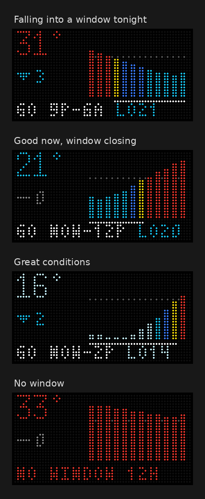

# Tidbyt Wet Bulb

Shows snowmaking conditions for Wakefield, MA on a Tidbyt: current wet bulb, the 3-hour trend, a 12-hour forecast chart, and the best snowmaking window. Updated hourly by GitHub Actions.



## Display

| Area | Meaning |
|---|---|
| Big number (top left) | Current wet bulb (F), colored by zone |
| Arrow + number | Change over the next 3 hours (cyan ▼ falling, orange ▲ rising, gray - flat) |
| Bars (right) | Next 12 hours, one bar per hour, colored by zone. Scale is 1px per degree (14F floor, 37F ceiling) |
| Dotted line | 28F - bars crossing it are in the no-go zone |
| White underline | Best window - longest run of hours at 27F or colder |
| Bottom row | `GO start-end LO##` (window and its lowest wet bulb), or `NO WINDOW 12H` |

### Zones (Backyard Snowstorm snowmaking chart)

| Wet bulb | Zone | Color |
|---|---|---|
| 19F and below | Great | Pale cyan |
| 20-23F | Good | Cyan |
| 24-26F | Marginal | Blue |
| 27F | Wet snow | Yellow |
| 28F and above | No go | Red |

## Data

| Value | Source |
|---|---|
| Current wet bulb | NWS latest observation, station KBED (Hanscom Field), via api.weather.gov |
| Fallback current | Open-Meteo `current` block, used when the NWS obs is missing or older than 90 min |
| 12-hour forecast | Open-Meteo hourly temperature, dewpoint, surface pressure |

Wet bulb is calculated from temperature, dewpoint and pressure with an iterative psychrometric solve (Magnus vapor pressure, WMO psychrometer coefficient). It matches the Backyard Snowstorm chart on 120 of 136 test cells after rounding, never off by more than 0.71F, and agrees with MetPy to within 0.15F.

Weather data by [Open-Meteo.com](https://open-meteo.com) (CC BY 4.0) and the National Weather Service.

## Off-season behavior

- The workflow only runs October through April.
- If the current wet bulb and all 12 forecast hours are above 34F, the app renders nothing and the workflow deletes the `wetbulb` installation, so it drops out of the Tidbyt rotation. It comes back on the first run that sees a cold enough hour.

## Config

Defaults live at the top of `wetbulb.star`. Override with `key=value` on `pixlet render`:

| Key | Default | Notes |
|---|---|---|
| `lat` / `lon` | 42.5039 / -71.0723 | Wakefield, MA |
| `station` | KBED | Any NWS station ID |
| `tz` | America/New_York | |
| `hide_above` | 34 | Set to 0 to always show |

## GitHub Actions setup

1. **Settings > Secrets and variables > Actions**, add:
   - `TIDBYT_DEVICE_ID`
   - `TIDBYT_API_KEY`
   (same values as the tidbyt-meals repo)
2. Runs hourly at :10 past the hour, Oct-Apr. Trigger manually from **Actions > Push Wet Bulb to Tidbyt > Run workflow**.
3. Each run logs the source used, the calculated wet bulb, and Open-Meteo's own wet bulb for the current hour as a cross-check.

## Local preview and tests

```
pixlet serve wetbulb.star            # live data, http://localhost:8080
PIXLET=pixlet python3 tests/run_tests.py   # offline tests, renders to tests/out/
```

The tests check the wet bulb math against the snowmaking chart (`tests/chart.csv`) and render fixture scenarios with the real app code: falling, rising, great, no-go, stale observation, missing observation, too warm (hidden), and forecast outage.
